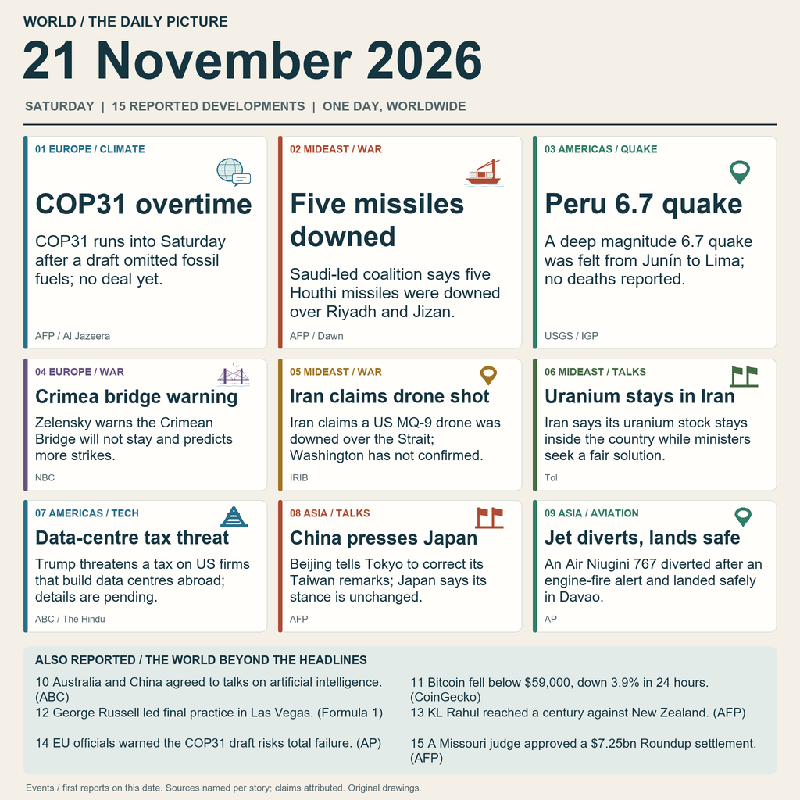

# 21 November 2026 — World News in One Image

[](https://make.fun/bounty/news-image-20261121)

A deterministic illustrated digest of Saturday 21 November 2026. The selected
composition uses three lead stories, six supporting panels and six concise
briefs, with six geographic groups and explicit attribution.



## Run

Python 3.13, standard library only; no package installation and no network:

```sh
python main.py
```

The default output is `/output/entry.png`. For a local destination:

```sh
python main.py --output-dir .local-output
```

The runtime copies the committed PNG byte-for-byte. It does not use fonts,
network access, timestamps, randomness or the working directory.

## Editorial data

`stories.json` records 15 bounded claims from the public 21 November edition,
with source URLs, dates, attribution and uncertainty preserved. The data was
used only to author the original geometric illustration; the submitted runtime
uses no network.

- Leads: COP31 negotiations, Saudi/Houthi missile interceptions, and the Peru earthquake.
- Supporting panels: Ukraine, Iran, US data-centre policy, China–Japan, aviation and markets.
- Briefs: Australia–China AI talks, Formula 1, cricket, COP31 risk and the Roundup settlement.

`tools/render_revision.py` and `tools/make_image.py` are authoring tools only;
Pillow is not needed to run `main.py`.

## Verification

```sh
python tools/check_editorial.py stories.json
python tools/verify_entry.py --report VERIFICATION.json
```

The verifier checks PNG structure, chunk CRCs, dimensions, byte cap, two
isolated deterministic runs, no network sockets, and standard-library imports.

## License

MIT; see `LICENSE`. Artwork is original geometric illustration.
